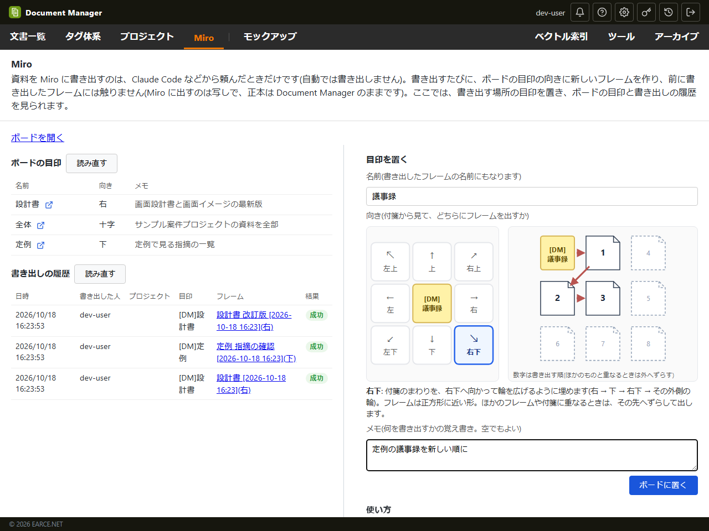

# Miro 連携

Document Manager の資料を、Miro のボードへ書き出すための連携です。
資料の正本は Document Manager のままで、Miro には写しを出します。書き出すのは頼まれたときだけです(自動では書き出しません)。

- **連携は1つだけ**です。管理者が1回「Miro と連携」した Miro のアカウントの権限で、すべての書き出しを行います
  (利用者ひとりずつは連携しません。Claude Code などから書き出しを頼む人が、Miro と連携しているとは限らないため)。
- **書き出すボードも1枚**です。ボードの目印(付箋)を基準に、書き出すたびに新しいフレームを作って並べます。
- 何も設定しない環境では、管理画面に「Miro 連携」のタブが出るだけで、利用者向けの画面には何も出ません。


## 1. Miro 側の準備(最初に1回)

1. Miro の右上のアイコン →「**開発者ハブ**」→「作成アプリ」→「**新しいアプリを作成する**」。
   - 開発者チームを選ぶ(作るよう求められたら作る。ライセンスは消費しません)。
   - 「**ユーザー認証トークンの有効期限を失効させる**」にチェックを入れる(あとから変えられません)。
     トークンに期限が付き、漏れたときの影響が小さくなります。
2. アプリの設定で:
   - 「**OAuth2.0 用のリダイレクト URI**」に、Document Manager の管理画面「Miro 連携」に出ている戻り先
     (`https://<公開URL>/api/miro/callback`)を追加する。一字一句同じであること。
     手元で試すときは `http://localhost:<ポート>/api/miro/callback` も使えます(`localhost` だけ http を許される)。
   - 「**アクセス権限**」で `boards:read` と `boards:write` だけにチェックを入れる。
   - 「アプリの URL」「ボードピッカー」は使いません。「アプリをインストールして OAuth トークンを取得」も押しません。
3. 「アプリの認証情報」のクライアントIDとクライアントシークレットを、次の 2 で Document Manager に渡します。
   **シークレットはパスワードと同じ扱い**です。チャットやリポジトリに置かないでください。

開発用のチームは試し用の場所です(メンバー5人・ボード3枚まで)。業務のボードに出すときは、連携のときに
業務のチームを選びます(チームでアプリの追加が管理者に限られている場合は、そのチームの管理者が連携します)。

## 2. Document Manager にアプリの値を渡す

次のどちらか。**環境変数があればそちらを使い**、管理画面からは変えられません。

| 渡し方 | 向いている環境 | 保存先 |
|---|---|---|
| **環境変数** `MIRO_CLIENT_ID` / `MIRO_CLIENT_SECRET` | クラウド(下の3)、構成をコードで管理する環境 | 秘密情報の保管庫(Secrets Manager など)。Document Manager のデータベースには入らない |
| **管理画面**「Miro 連携」の入力欄 | 小さな環境(サーバーの設定ファイルを書き換えずに済ませたい) | データベース(AES-256-GCM で暗号化)。保存後は表示しない |

Compose で動かす場合は、`deploy/compose.env` に `MIRO_CLIENT_ID` / `MIRO_CLIENT_SECRET` を書くか、空のままにして
管理画面で入力します。

## 3. 連携する

1. 管理画面「**Miro 連携**」で「**Miro と連携**」を押す。
2. Miro の許可の画面で、**資料を出すチーム**を選んで許可する。
3. Document Manager に戻ったら、書き出すボードを選ぶ(連携したチームのボードだけが候補に出ます)。

連携し直し・解除も同じ画面からできます。解除すると Miro 側のトークンも取り消します(ボードに出した資料は残ります)。

## 4. 資料を Miro に書き出す



Document Manager は、**頼まれたときだけ**資料を Miro に書き出します。自動では書き出しません
(打ち合わせで使っているボードが、知らないうちに変わらないように)。資料を足した・新しい版にしたあとも、頼まれるまでボードは変わりません。

- 書き出すたびに**新しいフレーム**を作り、頼まれた資料をその中に並べます。**前に書き出したフレームには触りません**(書き出したときの写しとして残ります)
- 書き出しは Claude Code などから頼みます(Document Manager の Skill の `miro-export`、API の `POST /api/miro/exports`)。
  画面からは、文書のプレビューの「**Miro に書き出す**」のアイコン(ボードの絵)で、表示中の資料 1 件を書き出せます。
  押すと、目印(または空いている所)とフレームの名前を選ぶ画面が出て、確かめてから書き出します。向きは目印の付箋に書いた向きに従います(書き込みの権限があり、Miro に出せる形式のときだけ出ます)
- **文書 ID で頼みます**(プロジェクトには縛られません)。プロジェクトを渡すと、資料を省いたときにそのプロジェクトの資料を全部出し、
  十字では目印の下にプロジェクトの概要カードを置きます
- 各資料の下に、名前・更新日・「**Document Manager で開く**」のリンク(共有リンク。常に最新の版が開く)を付け、
  資料とまとめてグループにします(人が動かすと一緒に動きます)
- 出せるもの:

| 資料 | Miro での出し方 |
|---|---|
| PDF | そのまま |
| PNG・JPEG | 画像として |
| HTML・Markdown・MHTML・draw.io | 「PDFでダウンロード」と同じ変換で PDF にして(PDF 変換サービスが要る) |
| Excel・Word・PowerPoint | 体裁つき表示の PDF(変換が済んでいるもの) |
| テキスト・CSV など | 出しません(理由が書き出しの記録に残ります) |

  1件6MBまで(Miro の API の上限)。資料の数によって数分かかります(実物で76件に約2分20秒。うち変換が約35秒)。

### 書き出す場所(目印)

ボードに、次のように書いた**付箋**(図形・文字でもよい)を置いておきます。

```
[DM]設計書
(右側)
基本設計書と画面設計の最新版
```

| 行 | 意味 |
|---|---|
| 1 行目 `[DM]名前` | **目印の名前**。書き出すときにこの名前で指します。書き出したフレームの名前にもなります |
| かっこで囲んだ行 | **向き**(下の表)。省くと右。「右側」「右へ」「→」のような書き方も読みます |
| それ以外の行 | **メモ**(何を書き出すかの覚え書き)。Document Manager は読まず、目印の一覧に載せるだけです |

`[DM]`・かっこは全角・半角、大文字・小文字を問いません。目印は、名前のほか、Miro の「**リンクをコピー**」で取った付箋・図形のリンクでも指せます。
どちらも無いときは書き出さず(`409`、`code: anchor_required`)、利用者に確かめてから、ボードの中身の右の空いている所に出せます(`free: true`)。

画面の上のメニューの「**Miro**」(Miro 連携がある環境だけに出ます)で、目印の付箋を置けます
(右側(600px)で名前・向き・メモを入れて「ボードに置く」。向きは、付箋のまわりの 8 つの置き場所を描いた図で選び、選んだ向きのフレームの形と中の並びが見えます。
ボードの中身の右の空いている所に置くので、Miro で開いて置きたい場所へドラッグします)。
左側に、ボードの目印の一覧(名前の横のアイコンで Miro のその付箋の所を開く)と、書き出しの履歴(全プロジェクト分。フレームへのリンク付き)が出ます。
閲覧だけの権限では、目印を置く欄は出ません。

### 向き

| 向き | フレームの置き場所 | フレームの形 |
|---|---|---|
| 右・左 | 目印の横。上の端を目印にそろえる | 横長(1 行 8 枚で折り返す) |
| 上・下 | 目印の上か下。左の端を目印にそろえる | 縦長(1 行 3 枚) |
| 右上・右下・左上・左下 | 目印のまわりを、その向きへ輪を広げるように埋める(下) | 正方形に近い形 |
| 十字 | 資料をタグで 4 つに分け、目印の斜め 4 つ(右上・右下・左上・左下の角)のフレームに出す。フレームの隙間が十字の線になる | 斜めと同じ |

- フレームの中は、向きにかかわらず**読む順**(左上から右へ、行が埋まったら次の行)。頼まれた資料の順(資料を省いたときはプロジェクトの資料一覧の順)
- フレームの名前は「**タイトル [YYYY-MM-DD hh:mm]**」(書き出したときの時刻)。タイトルは頼まれたもの → 目印の名前 → プロジェクト名 → 「Document Manager」
- ほかのフレーム・付箋などと重なるときは、向きの外側へずらします(同じ目印に何度書き出しても重なりません。十字は 4 つのフレームをまとめて右へずらします)
- 1 回の書き出しで「この資料はこの向き」の組を複数出せます(`groups`)
- **斜め**は、目印のマスを 0 番目とし、目印に近いマスから外へ埋めます。
  右上なら 1 周目は 右 → 上 → 右上、2 周目は 右右 → 右右上 → 上上 → 右上上 → 右右上上 … の順です。
  ほかのもの(手で置いた付箋・図形など)と重なるときは、マスを飛ばさずに重ならない所まで外へずらします
  (目印と同じ列の上・下のマスは縦へ、それ以外は段を崩さないよう横へ)。次のマスはずらしたあとの位置から決めるので、順番は崩れません。
  右下・左上・左下は向きを変えた順番です。画面の向きの図に、選んだ向きの順番が出ます
  - 目印の側の端でそろえます。目印と同じ段は、右下・左下ならフレームの上の端を目印の上の端に、右上・左上なら下の端を目印の下の端にそろえます。
    目印と同じ列は、右上・右下なら左の端を、左上・左下なら右の端を目印にそろえます
  - 段は棚のように積みます。外側の段は内側の段のいちばん外の端(右上なら、下の段でいちばん高いフレームの上の端)の外に置き、
    同じ段の中は内側のフレームの外へ横に並べます。フレームの大きさがまちまちでも重なりません
  - どのマスに出したかは書き出しの記録(`frames[].cell`)に残し、同じ目印に次に書き出すときに使います。Miro でフレームを消せば、そのマスは空きます

### 十字

資料をタグで 4 つに分け、目印の斜め 4 つのフレームに出します(`miro-layout.js`)。

| フレーム | 入る資料 | 見出しの色 |
|---|---|---|
| 左上: 要件定義〜設計 | `工程:要件定義` `基本設計` `詳細設計` `実装`(工程の順。実装は詳細設計の段) | 紫 |
| 左下: テスト〜リリース | `工程:単体テスト` `結合テスト` `受入テスト` `リリース` `運用`(工程の順) | 桃 |
| 右上: 管理 | `区分:管理` | 灰 |
| 右下: 会議 | `区分:会議`・`会議:`(日付順) | 定例は緑、臨時は橙 |
| 未分類(下) | どれにも当たらない資料 | なし |

- 書き出しで `project` を渡すと、目印のすぐ下にプロジェクトの名前・説明・資料の件数のカードを置きます(説明は 100 文字で切ります)。渡さなければ置きません
- 資料の無い区画はフレームを作りません
- `GET /api/miro/layout-report?documentIds=…`(または `?project=…`)で、十字で書き出したらどうなるか(未分類と理由・推定・表に無い値と候補)が分かります。
  **Miro は変えません**。未分類が 3 割を超えると `reviewRecommended: true` になるので、先にタグを見直します

**タグ**: 今のタグと同じ文字列(例 `区分:管理`)で、`:` より前を見出し、後ろを値として読みます。値は下の表だけを正とし、ほかの値は作りません。

| タグ | 値(この順で並べる) |
|---|---|
| `区分:` | 管理 / 会議(付いていれば、工程や段階のタグより優先) |
| `工程:` | 要件定義 / 基本設計 / 詳細設計 / 実装 / 単体テスト / 結合テスト / 受入テスト / リリース / 運用 |
| `段階:` | 準備 / 実施 / 実施後(回数があれば 実施 1 回目・実施 2 回目 …) |
| `会議:` | 定例 / 臨時(`区分:会議` だけで `会議:` が無ければ臨時) |
| `機能:` | プロジェクトごとに決める |
| `対象外:` | 工程の値(例 `対象外:運用`) |

- 1 つの資料に、同じ見出しのタグは 1 つだけ。2 つ以上あれば表の順で最初の 1 つを使い、報告(`duplicateTags`)に出します
- 表に無い値のタグは未分類として扱い、報告(`unknownValues`)に近い値の候補を出します
- 十字で使うのは `区分:` `工程:` `会議:` です。`段階:` `機能:` `対象外:` は、今は使いません(値の決まりだけを残しています)
- タグの並び(タグ体系)は、管理者がタグ体系の管理画面の「**Miro の十字のタグをそろえる**」で、この順にそろえられます(保存するまでは反映されません。`GET /api/miro/layout-tags`)

**タグが無いときの推定**: 題名 → フォルダ名の言葉から推定します(全角・半角、大文字・小文字、空白は区別しません)。
推定はタグとして保存せず、書き出すときにだけ使い、報告に「推定」(`basis: "inferred"`)として出します。確定は LLM 経由でタグを付けて行います。

| 含まれる言葉 | 推定するタグ |
|---|---|
| 議事録・会議・打合せ・MTG・定例 | `区分:会議`(定例 を含めば `会議:定例`) |
| 計画・体制・WBS・スケジュール・課題・リスク・見積・予算 | `区分:管理` |
| 要件 | `工程:要件定義` |
| 基本設計・方式設計 | `工程:基本設計` |
| 詳細設計・API・DB 設計・画面設計 | `工程:詳細設計` |
| 単体テスト / 結合テスト / 受入テスト・UAT | `工程:単体テスト` / `工程:結合テスト` / `工程:受入テスト` |
| リリース・移行・切り替え | `工程:リリース` |
| 運用・保守・マニュアル | `工程:運用` |

- 付けたタグがあれば、推定より常にそちらが勝ちます。表に無い値のタグしか無い見出しは推定しません
- `段階:` と `機能:` は推定しません
- フォルダ名は、`project` を渡したとき(そのプロジェクトのフォルダ)だけ使います

**日付**(右下の会議の並び): 題名 → ファイル名の順に、`2026-10-17` `2026/10/17` `2026.10.17` `20261017` `2026年10月17日` の書式の日付を探し、
最初に見つかったものを使います。年の無い `10/17` `10月17日` は、初版(最初の版)の登録日の年を補います(登録日より後になるなら前の年)。
見つからなければ初版の登録日を使い、報告の `notes` に出します(`date_from_first_upload`)。版を重ねても日付は変わりません。

### API

| API | 内容 |
|---|---|
| `GET /api/miro/anchors` | ボードの目印の一覧(名前・向き・メモ・リンク・最後に書き出した日時。書き方が読めないものは `problem`) |
| `POST /api/miro/anchors` `{name, direction?, note?}` | 目印の付箋をボードの空いている所に置く |
| `POST /api/miro/exports` | 書き出す(202。置くのは裏で行う)。下の本体 |
| `GET /api/miro/exports/:exportId` | 1 回の書き出しの記録(`running` / `done` / `failed`・フレーム・資料ごとの結果) |
| `GET /api/miro/exports` | 書き出しの履歴(全プロジェクト分。新しい順に 30 件、`?limit=` で 200 件まで) |
| `GET /api/miro/layout-report` | 十字で書き出したらどうなるか(上の「十字」) |

```json
{
  "anchor": "設計書",
  "documentIds": ["…", "…"],
  "project": "…",
  "direction": "右",
  "title": "設計レビュー"
}
```

- 場所は `anchor`(目印の名前)・`anchorUrl`(付箋・図形のリンク)・`free: true`(空いている所)のどれか 1 つ
- `project` は省けます。`documentIds` を省くときは `project` が要ります(そのプロジェクトの資料を全部)。古い版の文書 ID を渡すと、いまの版を出します
- 向きごとに分けるときは `groups: [{"documentIds": [...], "direction": "左", "title": "議事録"}, …]`(`documentIds` と一緒には使えない)
- `direction`: `right` / `left` / `up` / `down` / `upper-right` / `lower-right` / `upper-left` / `lower-left` / `cross`(日本語の 右・左上・十字 なども可)。
  省くと目印に書いた向き、それも無ければ右
- 断るとき: 目印が無い(`409 anchor_required`)・見つからない(`404 anchor_not_found`。`anchors` にボードの目印の名前)・
  同じ名前が複数(`409 anchor_ambiguous`)・向きが読めない(`400 anchor_unreadable`)・指示の誤り(`400`。`details` に理由の一覧)

#### Miro が一時的に断ったとき

Miro はフレームの作成を、ときどき数十秒続けて `500`(`code 3.0000`「Internal error occurred」)で断ります。
API の回数の制限(`429`)とは別で、残り回数に余裕があっても起き、同じ頼みを少しあとに送れば通ります(Miro のコミュニティにも同じ報告があります)。
資料・見出し・グループの作成は断られていません。

- フレームの作成は、5 秒・30 秒・60 秒と間を空けて 3 回やり直します(合わせて 1 分半ほど。`MIRO_FRAME_RETRY_DELAYS_MS`)。ほかの呼び出しは 2 秒・8 秒・30 秒(`MIRO_RETRY_DELAYS_MS`)
- それでも通らなければ、そのフレームの資料だけを失敗にして、ほかのフレームと概要カードは置き切ります。断られたフレームは Miro に何も残りません
- 記録の `documents[]` の失敗には `code`(`miro_unavailable`: 一時的に断られた / `miro_error`: Miro が断った)と `retryable`、
  記録に `retryDocumentIds`(一時的に断られた資料の ID)が付きます。同じ目印にこの ID だけで書き出せば出し直せます(次の空いている所に出ます)
- **自動では出し直しません**(打ち合わせのボードが、知らないうちに変わらないように)。AI は利用者に出し直すか確かめてから出し直します
  (同梱クライアントは結果に `retry.command` を付けます)。プレビューから書き出したときは「もう一度書き出す」ボタンが出ます
- ログには Miro の `x-request-id` を残します(Miro のサポートに問い合わせるときの手がかり)

### 書き出したあとの手直し

手直しは書き出しごとに行います。書き出し(`exportId`)を省くと、**頼んだ人の最後の書き出し**が対象です
(Document Manager が自分から書き出したフレームを直すことはありません)。
AI(Claude Code など)に「〇〇を△△の右に置いて」「囲みを付けて」と頼むと、地図を読んでから直します。

| API | 内容 |
|---|---|
| `GET /api/miro/map?exportId=…` | フレームごとの資料の位置・指示で置いた見出しと図形・人が足したもの・空いている所(位置はフレームの左上から)。**Miro は変えない** |
| `PATCH /api/miro/items/:documentId` | 資料を動かす(本体に `exportId` を足せる): `{nextTo: 文書ID, side: "right"\|"left"\|"above"\|"below"}` か `{frame?: フレームの ID か名前, x, y}`。見出しも一緒に動く |
| `POST /api/miro/layout` | 位置と色・見出しの文字・図形をまとめて当てる(下) |

```json
{
  "exportId": "…",
  "frameId": "…",
  "items":  [{"documentId": "…", "x": 300, "y": 500, "color": "#fde68a"}],
  "labels": [{"text": "まとめ", "x": 600, "y": 120, "width": 1000, "fontSize": 48, "color": "#1e3a8a"}],
  "shapes": [{"x": 1700, "y": 600, "width": 800, "height": 900, "fillColor": "#e0f2fe", "fillOpacity": 0.25,
              "borderColor": "#0284c7", "borderWidth": 2, "borderStyle": "dashed"}],
  "frame":  {"width": 4000, "height": 3000}
}
```

| 項目 | 内容 |
|---|---|
| 位置 | すべて**フレームの左上からの中心の位置**。`exportId` を省くと頼んだ人の最後の書き出し、`frameId` を省くと最初のフレーム |
| `items` | 資料を動かす(見出しも一緒に)。`color` で見出しの背景を塗る(`null` で外す) |
| `labels` | 見出しの文字 |
| `shapes` | 囲み・矢印・区切りの線など。**Miro では重なりの順を指定できず、あとから置いた図形が資料の上に重なる**ので、背景は `fillOpacity` を小さくする |
| `frame` | フレームの大きさ。省略すると中身に合わせて広げる(左上は動かさず、縮めはしない) |
| 当て直し | 前に置いた見出しの文字と図形を片付けてから置く(`keepDecorations: true` で残す。`clearDecorations: true` だけで片付ける) |
| 失敗 | 正しくないところが1つでもあれば、何も動かさずに理由の一覧(`details`)を返す |

### 見る人

ボードは Miro の共有のしかた(チームのメンバー・招待)で見せます。見る人に Document Manager 側の作業は要りません。
見出しの「Document Manager で開く」は、Document Manager にログインできる人だけが開けます。

### 権限

| 操作 | 必要な権限 |
|---|---|
| 書き出しの履歴・目印の一覧・地図を見る | 閲覧だけの権限でも可 |
| 書き出す・目印を置く・手直し | 書き込みの権限 |
| Miro との連携・書き出すボード | 管理者 |

## トークンの扱い

- アクセストークンは1時間、更新用トークンは60日で切れます。期限が近づいたら、使うときに自動で更新します。
- トークンはデータベースに**暗号化して**保存します(鍵は `SESSION_SECRET` から派生)。画面にも API の応答にも出しません。
- 60日間まったく使われない、Miro 側で許可を取り消す、`SESSION_SECRET` を変える、のいずれかで連携は切れます。
  管理画面に「連携し直しが必要」と出るので、連携し直してください。

## クラウドで動かす場合(AWS / GCP / Azure)

どのクラウドでも、次の形で動かせます。

| 項目 | AWS(ECS など) | GCP(Cloud Run など) | Azure(Container Apps / App Service) |
|---|---|---|---|
| アプリの値・`SESSION_SECRET` | Secrets Manager / Parameter Store から環境変数で渡す | Secret Manager から環境変数で渡す | Key Vault の参照で環境変数に渡す |
| データベース | RDS / Aurora(Postgres) | Cloud SQL(Postgres) | Azure Database for PostgreSQL |
| `api.miro.com` への外向きの通信 | プライベートサブネットなら NAT ゲートウェイが要る | 既定で出られる(VPC の出口を絞っているなら Cloud NAT) | 既定で出られる(出口を絞っているなら NAT ゲートウェイ) |

気をつけること:

- **台数が増えても使えます。** トークンの更新は、データベースの上で順番を取った1台だけが行い、ほかの台は更新された
  トークンを読んで使います(更新用トークンは1回使うと無効になるため、同時に更新すると連携が切れたと誤って判断する)。
  順番を持った台が落ちても、45秒(`MIRO_REFRESH_LOCK_SECONDS`)たてばほかの台が取り直します。
- **全台で `SESSION_SECRET` を同じにする。** トークンの暗号化の鍵と、連携の手続き(許可の画面とのやりとり)の署名に使います。
  違うと、ほかの台が保存したトークンを読めず「連携し直しが必要」になります。
- **セッションは全台で共有する。** 連携の手続きの途中の情報をセッションに置くため。Postgres で動かせば、
  セッションも Postgres に保存されます。
- **戻り先の URL**: ロードバランサーや CDN(CloudFront、Cloud CDN、Front Door)の後ろでは、サーバーから見える URL が
  公開 URL と違うことがあります(アプリが信用する中継は1段だけ)。`PUBLIC_ORIGIN` に公開 URL を設定するか、
  `MIRO_REDIRECT_URI` で戻り先を明示してください。管理画面に出る戻り先が、Miro に登録したものと同じであることを確かめます。

## 手元で試す

```bash
node tools/dev/miro-setup.mjs
```

で、クライアントIDとシークレットを `~/.document-manager/miro-dev.env` に保存できます(シークレットは画面に `*` で出ます)。
管理画面から入力しても同じです。

## 設定

| 環境変数 | 既定値 | 意味 |
|---|---|---|
| `MIRO_CLIENT_ID` | (未設定) | Miro のアプリのクライアントID。シークレットと両方そろったときだけ使う |
| `MIRO_CLIENT_SECRET` | (未設定) | Miro のアプリのクライアントシークレット |
| `MIRO_REDIRECT_URI` | 公開URL + `/api/miro/callback` | 許可のあとの戻り先 |
| `MIRO_REFRESH_LOCK_SECONDS` | `45` | トークンを更新する順番を、1台が持っていられる時間 |
| `MIRO_TIMEOUT_SECONDS` | `30` | Miro の応答を待つ上限 |
| `MIRO_EXPORT_CONCURRENCY` | `4` | 資料を置くとき、同時に書き込む件数(前の名前 `MIRO_SYNC_CONCURRENCY` も効く) |
| `MIRO_EXPORT_LOCK_SECONDS` | `600` | 1つの書き出しの手直しの順番を、1台が持っていられる時間。書き出しが途中で止まったとみなすまでの時間にも使う(前の名前 `MIRO_SYNC_LOCK_SECONDS` も効く) |
| `MIRO_RETRY_DELAYS_MS` | `2000,8000,30000` | Miro の一時的な失敗のやり直しの待ち時間 |
| `MIRO_FRAME_RETRY_DELAYS_MS` | `5000,30000,60000` | フレームの作成のやり直しの待ち時間(Miro が数十秒続けて断ることがあるため長め) |
